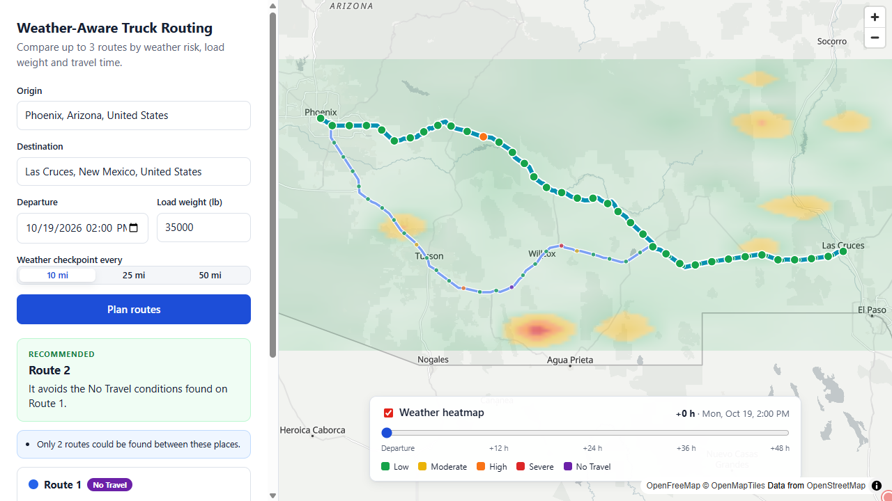

# Weather-Aware Truck Routing

A React + Django web app that helps a truck driver choose the safest route based on
**weather**, **load weight** and **travel time**.

The driver enters an origin, a destination, a departure time and the load weight. The app
finds up to 3 routes, checks the forecast at checkpoints every 10 / 25 / 50 miles **for the
hour the truck will actually be there**, rates each checkpoint with the risk rules, and
recommends the best route. Everything is shown on a map with a weather heatmap and a
0–48 hour forecast slider.

- **Live app:** https://weather-aware-truck-routing-pi.vercel.app
- **API:** https://weather-truck-routing-api-alpha.vercel.app/api/health/
- **Video walkthrough:** _coming soon_ <!-- TODO: add the Loom link -->

 <!-- TODO: add a screenshot -->

---

## Features

- Origin / destination search with autocomplete (keyboard friendly).
- Up to **3 route options**, drawn on the map in different colours.
- **Checkpoints** every 10, 25 or 50 miles (plus start and end), each with its ETA.
- **Weather per checkpoint** (wind, rain, snow) for the forecast hour nearest the ETA.
- **Risk level** per checkpoint (Low, Moderate, High, Severe, No Travel), including the
  load-weight rules. Click a checkpoint to see its ETA, weather, level and cause.
- **Route cards:** distance, duration, arrival time, miles per risk level (stacked bar),
  Severe/High miles, average risk and worst level. Hovering a card highlights its route.
- **Recommendation** with a plain-English reason, e.g.
  _"Fewest Severe-risk miles (5 vs Route 1: 20)."_
- **Weather heatmap** over the trip corridor with a **0–48 h slider**. All 49 hours are
  loaded at once, so moving the slider needs no network requests.
- Loading skeletons, clear error messages and notices (e.g. "Only 2 routes could be found").

## Tech stack

| Part     | Technology |
| -------- | ---------- |
| Backend  | Python 3.12, Django 6, Django REST Framework, requests, pytest |
| Frontend | React 19, TypeScript, Vite, MapLibre GL (via react-map-gl) |
| Map      | OpenFreeMap "Positron" vector tiles (free, no key) |

## Third-party APIs (and why)

| Purpose | Service | Why |
| ------- | ------- | --- |
| Routing | [OSRM public server](https://project-osrm.org/) | Free and key-less; returns alternative routes and the driving time of every road segment (needed for checkpoint ETAs). |
| Geocoding / autocomplete | [Photon](https://photon.komoot.io/) | Free OpenStreetMap search built for search-as-you-type. (Nominatim's usage policy forbids autocomplete.) |
| Weather | [Open-Meteo](https://open-meteo.com/) | Free and key-less; hourly forecasts in mph and inches; many locations in one request. |
| Optional | [Mapbox](https://www.mapbox.com/) Directions + Geocoding | Used instead of OSRM/Photon when `MAPBOX_TOKEN` is set. |

API keys (if any) live only in the backend `.env`; the browser never sees them.

---

## How it works

```
Browser (React)                         Django API                              External APIs
──────────────                          ──────────                              ─────────────
Trip form ── POST /api/plan/ ────────▶  1. fetch up to 3 routes ─────────────▶  OSRM / Mapbox
                                        2. checkpoints every N miles + ETAs
                                        3. ONE batched forecast request ─────▶  Open-Meteo
                                        4. risk per checkpoint (rules below)
                                        5. route summaries + recommendation
Map + cards ◀──────────── JSON ──────
Heatmap ─── GET /api/heatmap/ ───────▶  15 x 15 grid x 49 hours, cached 10 min ▶ Open-Meteo
Autocomplete ── GET /api/geocode/ ───▶  place search, cached 1 day ──────────▶  Photon / Mapbox
```

### Backend layout (`backend/planner/`)

| Module | Responsibility |
| ------ | -------------- |
| `logic/risk.py` | Risk levels and the wind / rain / snow tables. |
| `logic/assessment.py` | Worst-of-three plus the load-weight rules. |
| `logic/geo.py` | Haversine distance and interpolation. |
| `logic/sampling.py` | Places checkpoints every N miles along the road polyline. |
| `logic/checkpoints.py` | ETA for each checkpoint from per-segment driving times. |
| `logic/summary.py` | Miles per level, weighted average risk, No Travel flag. |
| `logic/recommendation.py` | Ranks routes and explains the choice. |
| `logic/heatmap.py` | Heatmap grid and smooth intensity. |
| `services/` | One client per external API (`routing`, `weather`, `geocoding`) plus a shared HTTP helper. |
| `trip_planner.py` | Combines services and logic into a trip plan. |
| `corridor_heatmap.py` | Builds the 0–48 h heatmap (with caching). |
| `serializers.py`, `views.py`, `urls.py` | Request validation, endpoints and JSON output. |

Everything in `logic/` is pure Python (no HTTP, no Django), so every rule is unit-tested
directly.

### Frontend layout (`frontend/src/`)

| Path | Responsibility |
| ---- | -------------- |
| `api/` | Typed API client and the shared JSON types. |
| `hooks/` | `useTripPlanner` (plan, then heatmap), `usePlaceSearch` (debounced autocomplete). |
| `components/` | Form, autocomplete, map, popups, route cards, heatmap panel, legend. |
| `map/` | MapLibre layer styles and GeoJSON, heatmap images, bounds, MapLibre worker setup. |

---

## Risk rules

Each checkpoint gets a level for wind, rain and snow; **the worst of the three** is the
weather level.

| Level     | Wind (mph) | Rain (in/hr)  | Snow (in/hr) |
| --------- | ---------- | ------------- | ------------ |
| Low       | < 25       | < 0.10        | < 0.5        |
| Moderate  | 25 – 34    | 0.10 – 0.25   | 0.5 – 1.0    |
| High      | 35 – 44    | 0.25 – 0.50   | 1.0 – 2.0    |
| Severe    | 45 – 54    | 0.50 – 1.00   | 2.0 – 3.0    |
| No Travel | ≥ 55       | > 1.00        | > 3.0        |

**Load rules** are then applied. They can only raise the level, never lower it:

- wind ≥ 55 mph → **No Travel** for any load
- wind 45–54 mph and load > 30,000 lb → **No Travel**
- wind 35–44 mph and load > 40,000 lb → **Severe**

### How the boundaries are read

Forecast values are decimals (e.g. 34.6 mph), so every range is read as **"from the lower
number, up to the next level"**:

- Wind: 25 ≤ w < 35 is Moderate, so 34.9 is Moderate and 35.0 is High.
- Rain: 0.10 ≤ r < 0.25 Moderate, 0.25 ≤ r < 0.50 High, **0.50 ≤ r ≤ 1.00 Severe**,
  r > 1.00 No Travel. Exactly 1.00 is still Severe, because the table says "> 1.00".
- Snow works the same way: exactly 3.0 is Severe, and above 3.0 is No Travel.
- "> 30,000 lb" and "> 40,000 lb" are strict: exactly 30,000 lb does not trigger the rule.
- Rain = Open-Meteo `rain` + `showers` (steady rain plus shower rain).
- Wind = sustained 10 m wind speed (`wind_speed_10m`).

## Recommendation

Routes are compared one criterion at a time, in the order given by the spec:

1. fewest **Severe** miles
2. fewest **High** miles
3. lowest **average risk**
4. shortest **travel time**

Details:

- A **No Travel** stretch is worse than any Severe one, so routes with No Travel conditions
  rank after all routes without them (fewest No Travel miles first). If every route has
  No Travel conditions, the app says so and suggests delaying departure.
- Each checkpoint's level applies to the road **from that checkpoint to the next one**.
  The destination checkpoint owns no miles, but No Travel there still flags the route.
- Average risk is weighted by miles on a 0 (Low) … 4 (No Travel) scale.
- Miles are compared to 0.1 mile and average risk to 0.01, so floating-point noise can
  never decide between two routes.
- The reason names the first criterion where the winner beats the runner-up.

## Route options

The free OSRM server often returns only 1–2 alternatives. When fewer than 3 come back, the
backend asks OSRM for routes through a detour point on either side of the trip's midpoint
(first 15% of the trip distance to the side, then 30%). These are real drivable routes,
labelled **Detour** in the UI, and kept only if they are:

- at most 1.5× slower than the fastest route,
- not a duplicate of a route already found.

If a detour drives out to its detour point and straight back up a side road (a "spur"),
that out-and-back part is cut off first. If still fewer than 3 routes are found, the UI
says so instead of inventing one.

## Heatmap

- A 15 × 15 grid covers the bounding box of all routes, plus 10% padding.
- Hourly forecasts for hours 0–48 after departure come from one batched request and are
  cached for 10 minutes. Changing only the load re-scores the cached data.
- Each cell's intensity moves smoothly between levels (e.g. 30 mph is halfway from Moderate
  to High) but always stays inside the official level band. The colours never contradict
  the risk rules.
- The frontend turns each hour into a small image. Each pixel blends the four nearest grid
  points (bilinear interpolation), with rows placed in map (Mercator) space so the image
  lines up exactly with the grid. All 49 images are built once when the data arrives; the
  slider only swaps which pre-built image the map shows, so it stays smooth.
- Routes, checkpoints and the heatmap are all drawn by MapLibre itself (no extra WebGL
  library), which keeps the bundle small and renders reliably on older laptop GPUs.
  Highlighting a route only changes a style expression; the data is not rebuilt.

---

## Running locally (Windows PowerShell)

Requirements: Python 3.12+, Node.js 20+.

### 1. Backend

```powershell
cd backend
python -m venv .venv
.\.venv\Scripts\Activate.ps1
pip install -r requirements.txt
# create backend\.env (see "Environment variables" below)
python -m pytest            # run the tests
python manage.py runserver  # API on http://127.0.0.1:8000/api/
```

### 2. Frontend (in a second terminal)

```powershell
cd frontend
npm install
# create frontend\.env with VITE_API_URL (see below)
npm run dev                 # app on http://localhost:5173
```

Open http://localhost:5173. Pick an origin and destination from the suggestions, set the
departure and load, and click **Plan routes**.

Other frontend commands: `npm run build` (type-check + production build), `npm run lint`.

## Deployment

Both apps are on [Vercel](https://vercel.com) (free Hobby plan), as two projects from this
repository:

| Project | Root directory | Preset | Environment variables |
| ------- | -------------- | ------ | --------------------- |
| Backend | `backend` | Django (Python serverless function, see `backend/vercel.json`) | `DJANGO_SECRET_KEY`, `DJANGO_DEBUG=false`, `DJANGO_ALLOWED_HOSTS=.vercel.app`, `CORS_ALLOWED_ORIGINS=<frontend URL>` |
| Frontend | `frontend` | Vite | `VITE_API_URL=<backend URL>/api` |

Every push to `main` redeploys both projects.

## Environment variables

There is no example file. Create the `.env` files yourself; both are git-ignored.

### `backend/.env`

| Variable | Required | Example | Meaning |
| -------- | -------- | ------- | ------- |
| `DJANGO_SECRET_KEY` | yes (in production) | `a-long-random-string` | Django's secret key. |
| `DJANGO_DEBUG` | no | `true` | Debug mode. Defaults to `false`. |
| `DJANGO_ALLOWED_HOSTS` | yes (in production) | `localhost,127.0.0.1,api.example.com` | Comma-separated host names the API answers to. |
| `CORS_ALLOWED_ORIGINS` | yes (in production) | `http://localhost:5173,https://app.example.com` | Comma-separated frontend origins allowed to call the API. |
| `MAPBOX_TOKEN` | no | `pk.…` | If set, Mapbox is used for routing and geocoding instead of OSRM / Photon. |
| `HTTP_USER_AGENT` | no | `WeatherAwareTruckRouting/1.0 (you@example.com)` | Identifies the app to OSRM / Photon. A contact address is good practice. |
| `HTTP_TIMEOUT_SECONDS` | no | `20` | Timeout for each external API call. |

Example for local development:

```env
DJANGO_SECRET_KEY=change-me
DJANGO_DEBUG=true
DJANGO_ALLOWED_HOSTS=localhost,127.0.0.1
CORS_ALLOWED_ORIGINS=http://localhost:5173
MAPBOX_TOKEN=
HTTP_USER_AGENT=WeatherAwareTruckRouting/1.0
HTTP_TIMEOUT_SECONDS=20
```

### `frontend/.env`

| Variable | Required | Example | Meaning |
| -------- | -------- | ------- | ------- |
| `VITE_API_URL` | yes | `http://127.0.0.1:8000/api` | Base URL of the Django API. |

## API reference

| Method | Path | Description |
| ------ | ---- | ----------- |
| `GET` | `/api/health/` | Liveness check, returns `{"status": "ok"}`. |
| `GET` | `/api/geocode/?q=dallas` | Place suggestions: `{"results": [{"label", "lat", "lon"}]}`. |
| `POST` | `/api/plan/` | Body: `{"origin": {"lat", "lon"}, "destination": {...}, "departure": ISO-8601, "load_lb": number, "interval_miles": 10 \| 25 \| 50}`. Returns the routes (geometry, checkpoints, summary), the recommendation and notices. |
| `GET` | `/api/heatmap/?south=&west=&north=&east=&start=&load_lb=` | 225 grid points and 49 hourly frames of intensity (0–1). |

Validation:

- Departure must be within the next 7 days (the forecast range).
- Load must be between 0 and 80,000 lb (the U.S. federal gross weight limit).
- Origin and destination must be different places.

Status codes: invalid input returns `400` with field messages, an impossible trip `422`,
and an external service outage `502`.

## Testing

```powershell
cd backend
python -m pytest
```

The backend suite (200+ tests) covers:

- every boundary of the wind, rain and snow tables, and every load rule
- checkpoint spacing and ETAs
- route summaries and every step of the recommendation order
- the API clients, with all external calls mocked
- the endpoints

The frontend is type-checked in strict mode (`npm run build`) and linted (`npm run lint`).

## Known limitations

- **Car routing, not truck routing.** OSRM's public server and Mapbox use car profiles. They
  don't know truck restrictions (low bridges, weight limits, hazmat routes) or truck speeds.
  ETAs are car ETAs.
- **No driver breaks.** ETAs assume continuous driving (no hours-of-service rest stops).
- **Forecast resolution.** Forecasts are hourly and come from weather models on a grid of a
  few kilometres. Points within about 1 km share a forecast. The heatmap uses a 15 × 15 grid,
  which is coarse for very long trips.
- **Forecast range.** Departures more than 7 days ahead are rejected.
- **Serverless cache.** On Vercel the in-memory cache (heatmap forecasts, place search)
  lives only as long as one function instance, so repeat requests are sometimes slower.
  Results are always the same.
- **Free public services.** OSRM's demo server, Photon and Open-Meteo have rate limits and no
  uptime guarantee. Responses are cached where possible to stay polite.
